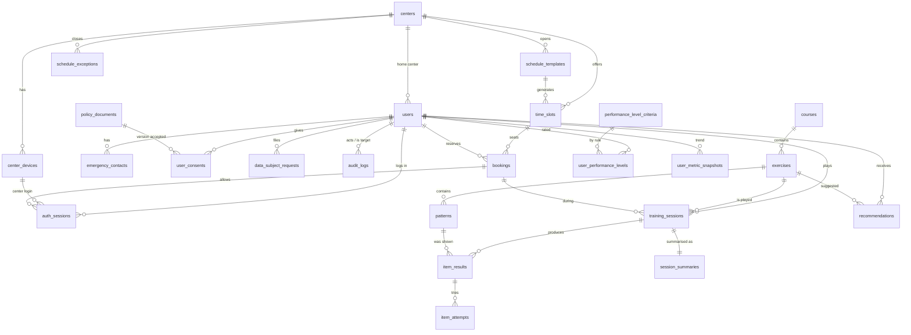

# Database

PostgreSQL 17 on Neon, accessed through Prisma 7. The schema is split into one file per
lane under `prisma/schema/`; migrations are plain SQL under `prisma/migrations/`.

- 24 tables, designed from the SRS and the four module reports.
- Names: `snake_case` tables and columns (mapped from `camelCase` Prisma fields).
- Keys: `uuid` v7 (time-ordered). Timestamps: `timestamptz`, stored in UTC.
- Money-like precision is not needed; percentages are `numeric(5,2)`, durations are
  integer milliseconds.

## Overview



## Tables by lane

### identity — `identity.prisma`, `centers.prisma` (Chanon)

| Table                   | Purpose                                                         | Notes                                                                                                                                                                 |
| ----------------------- | --------------------------------------------------------------- | --------------------------------------------------------------------------------------------------------------------------------------------------------------------- |
| `users`                 | Every account: elderly users and admins                         | `phone` unique login id (NULL after anonymisation); `role` USER/ADMIN; `credential_hash` bcrypt of PIN or password; lockout counters; birth date, gender, home center |
| `emergency_contacts`    | Relatives to call                                               | Deleted with the user                                                                                                                                                 |
| `auth_sessions`         | Server-side login sessions                                      | Stores SHA-256 of the cookie token; `context` HOME/CENTER; device and booking for center logins; `ended_at` + reason                                                  |
| `policy_documents`      | Versions of the privacy notice and terms of use                 | Unique `(type, version)`; immutable once published                                                                                                                    |
| `user_consents`         | **Append-only** PDPA consent ledger                             | One row per grant/withdrawal per purpose, pointing at the exact policy version                                                                                        |
| `data_subject_requests` | Access / rectification / erasure / restriction / objection      | `due_at` = 30 days; handled by an admin                                                                                                                               |
| `audit_logs`            | **Append-only** trail of privacy- and security-relevant actions | Actor, action, entity, target user, small metadata                                                                                                                    |
| `centers`               | Community centers                                               | `code` unique; `timezone` for slot generation                                                                                                                         |
| `center_devices`        | Shared devices registered at a center                           | Type, brand, model, serial, OS, screen, `max_touch_points`, purchase year; who registered / approved / revoked and when; SHA-256 of the device token                  |

### booking — `booking.prisma` (Chanon)

| Table                 | Purpose                              | Notes                                                                                                    |
| --------------------- | ------------------------------------ | -------------------------------------------------------------------------------------------------------- |
| `schedule_templates`  | Weekly opening hours per center      | `day_of_week` 0–6, minutes after local midnight, `capacity`, effective range                             |
| `schedule_exceptions` | Special closures or capacity changes | Whole day when minutes are NULL                                                                          |
| `time_slots`          | Concrete bookable periods            | Unique `(center_id, start_at)`; `booked_count` guarded by CHECK ≤ `capacity`                             |
| `bookings`            | A user's seat in a slot              | Status BOOKED / CHECKED_IN / COMPLETED / CANCELLED / NO_SHOW; partial unique indexes stop double booking |

### content — `content.prisma` (Apinan)

| Table       | Purpose                                    | Notes                                                                                               |
| ----------- | ------------------------------------------ | --------------------------------------------------------------------------------------------------- |
| `courses`   | A course and its default training settings | Difficulty 1–5; DRAFT / PUBLISHED / ARCHIVED; soft delete                                           |
| `exercises` | A set of items inside a course             | Overrides for attempts, modes, timing (NULL = inherit); soft delete                                 |
| `patterns`  | One item: steps on the 3x3 grid as JSON    | `steps` = PatternSteps; derived `sequence_length`, `has_simultaneous`; `version` increments on edit |

### engine — `engine.prisma` (Supanat)

| Table               | Purpose                                              | Notes                                                                               |
| ------------------- | ---------------------------------------------------- | ----------------------------------------------------------------------------------- |
| `training_sessions` | One run of one exercise in one mode                  | Where it happened (context, center, device, booking); snapshot of settings in force |
| `item_results`      | Outcome of each item — **the hand-off to analytics** | Snapshot of expected steps + pattern version; correctness, attempts, response time  |
| `item_attempts`     | Every try, with raw taps and timing                  | Server-verified; inter-tap intervals                                                |

### analytics — `analytics.prisma` (Saruta)

| Table                        | Purpose                                     | Notes                                                         |
| ---------------------------- | ------------------------------------------- | ------------------------------------------------------------- |
| `session_summaries`          | Metrics per completed session               | Accuracy %, response time, attempts, longest correct sequence |
| `performance_level_criteria` | Thresholds for levels 1–4                   | Data, not code, so they can be tuned                          |
| `user_performance_levels`    | A user's level per difficulty, with history | One `is_current` row per (user, difficulty)                   |
| `user_metric_snapshots`      | Day / week / month roll-ups and trend       | Moving average, slope, direction                              |
| `recommendations`            | Suggested next exercise                     | Reason + status                                               |

## Rules enforced by the database

These live as hand-written SQL at the end of the first migration because Prisma cannot
express them. Prisma Migrate leaves them alone when diffing.

| Rule                                                           | Mechanism                                                     |
| -------------------------------------------------------------- | ------------------------------------------------------------- |
| One active booking per user per slot                           | partial unique index `bookings_active_slot_user_key`          |
| One active booking per user per day                            | partial unique index `bookings_active_user_day_key`           |
| A slot can never be overbooked                                 | `CHECK (booked_count BETWEEN 0 AND capacity)` on `time_slots` |
| One current performance level per user per difficulty          | partial unique index `user_performance_levels_current_key`    |
| An ACTIVE device has an approver and approval time             | CHECK on `center_devices`                                     |
| A CENTER training session names its center                     | CHECK on `training_sessions`                                  |
| Difficulty is 1–5, performance level is 1–4, accuracy is 0–100 | CHECKs                                                        |
| A pattern has at least 2 steps                                 | CHECK on `patterns.sequence_length`                           |
| Phone numbers are 9–15 digits                                  | CHECK on `users.phone`                                        |
| Schedule minutes and days are in range                         | CHECKs on `schedule_templates`, `schedule_exceptions`         |

## JSON columns

| Column                                          | Shape                                   | Defined in                                                                                       |
| ----------------------------------------------- | --------------------------------------- | ------------------------------------------------------------------------------------------------ |
| `patterns.steps`, `item_results.expected_steps` | `PatternSteps`                          | `src/modules/content/contracts.ts`, [`contracts/pattern-format.md`](contracts/pattern-format.md) |
| `item_attempts.taps`                            | `AttemptTaps`                           | `src/modules/engine/contracts.ts`                                                                |
| `training_sessions.client_info`                 | free-form, non-identifying client facts | engine                                                                                           |
| `audit_logs.metadata`                           | small, non-sensitive context            | identity                                                                                         |

Always parse JSON read from the database with its Zod schema before using it.

## Data lifecycle

- **Users** are never hard-deleted. Erasure anonymises the row (`status = ANONYMIZED`,
  `phone = NULL`, names replaced, emergency contacts deleted) so aggregated statistics
  keep working without identifying anyone.
- **Content** is soft-deleted with `deleted_at`.
- **Results** are immutable once a session is completed.
- **Consent and audit rows** are append-only.

## Migration workflow

```bash
# 1. edit prisma/schema/<your-lane>.prisma
pnpm db:migrate --name <lane>_<what_changed>   # creates SQL and applies it to YOUR database
# 2. read the generated SQL in prisma/migrations/<timestamp>_<name>/migration.sql
# 3. commit the schema file and the migration together
```

- One migration per pull request. Rebase on `staging` first; if a newer migration landed,
  delete yours, run `pnpm db:migrate` again, commit.
- Never edit or delete a migration that has reached `staging`.
- Destructive changes (drop / rename column, change type) need the lead's approval and a
  note in the PR on how existing data is preserved. Prefer add → backfill → remove over
  two releases.
- Hand-written SQL (CHECK constraints, partial indexes, data backfills) goes at the end of
  the generated migration file with a comment.
- CI applies every migration to an empty PostgreSQL and fails if the result differs from
  the schema (`pnpm db:drift`).
- Deploys run `prisma migrate deploy` against the Neon branch **before** the new code goes
  live, so a migration must be compatible with the code that is currently running.

## Local and shared databases

| Database                                       | Who                   | How it gets its schema                |
| ---------------------------------------------- | --------------------- | ------------------------------------- |
| Your dev database (Neon `dev/<name>` or local) | you                   | `pnpm db:migrate`, `pnpm db:seed`     |
| Neon `staging`                                 | everyone, via the app | deploy workflow on merge to `staging` |
| Neon `production`                              | real users            | deploy workflow on merge to `main`    |

Never point your laptop at the staging or production database.
