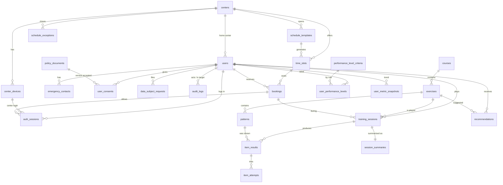

# Database

PostgreSQL 17 on Neon, accessed through Prisma 7. The schema is split into one file per
lane under `prisma/schema/`; migrations are plain SQL under `prisma/migrations/`.

- 24 tables, designed from the SRS and the four module reports.
- Names: `snake_case` tables and columns (mapped from `camelCase` Prisma fields).
- Keys: `uuid` v7 (time-ordered). Timestamps: `timestamptz`, stored in UTC.
- Money-like precision is not needed; percentages are `numeric(5,2)`, durations are
  integer milliseconds.
- **Soft delete only:** no row is ever physically deleted. 20 tables carry `deleted_at`;
  the 4 append-only ledgers do not. See [Soft delete](#soft-delete).

## Overview



## Tables by lane

### identity — `identity.prisma`, `centers.prisma` (Chanon)

| Table                   | Purpose                                                         | Notes                                                                                                                                                                 |
| ----------------------- | --------------------------------------------------------------- | --------------------------------------------------------------------------------------------------------------------------------------------------------------------- |
| `users`                 | Every account: elderly users and admins                         | `phone` login id, unique among live rows (NULL after anonymisation); `role` USER/ADMIN; `credential_hash` (bcrypt); lockout counters; birth date, gender, home center |
| `emergency_contacts`    | Relatives to call                                               | Kept on erasure, with the personal fields overwritten                                                                                                                 |
| `auth_sessions`         | Server-side login sessions                                      | Stores SHA-256 of the cookie token; `context` HOME/CENTER; device and booking for center logins; `ended_at` + reason                                                  |
| `policy_documents`      | Versions of the privacy notice and terms of use                 | Unique `(type, version)`; immutable once published                                                                                                                    |
| `user_consents`         | **Append-only** PDPA consent ledger                             | One row per grant/withdrawal per purpose, pointing at the exact policy version                                                                                        |
| `data_subject_requests` | Access / rectification / erasure / restriction / objection      | `due_at` = 30 days; handled by an admin                                                                                                                               |
| `audit_logs`            | **Append-only** trail of privacy- and security-relevant actions | Actor, action, entity, target user, small metadata                                                                                                                    |
| `centers`               | Community centers                                               | `code` unique among live rows; `timezone` for slot generation                                                                                                         |
| `center_devices`        | Shared devices registered at a center                           | Type, brand, model, serial, OS, screen, `max_touch_points`, purchase year; who registered / approved / revoked and when; SHA-256 of the device token                  |

### booking — `booking.prisma` (Chanon)

| Table                 | Purpose                              | Notes                                                                                                    |
| --------------------- | ------------------------------------ | -------------------------------------------------------------------------------------------------------- |
| `schedule_templates`  | Weekly opening hours per center      | `day_of_week` 0–6, minutes after local midnight, `capacity`, effective range                             |
| `schedule_exceptions` | Special closures or capacity changes | Whole day when minutes are NULL                                                                          |
| `time_slots`          | Concrete bookable periods            | Unique `(center_id, start_at)` among live rows; `booked_count` guarded by CHECK ≤ `capacity`             |
| `bookings`            | A user's seat in a slot              | Status BOOKED / CHECKED_IN / COMPLETED / CANCELLED / NO_SHOW; partial unique indexes stop double booking |

### content — `content.prisma` (Apinan)

| Table       | Purpose                                    | Notes                                                                                               |
| ----------- | ------------------------------------------ | --------------------------------------------------------------------------------------------------- |
| `courses`   | A course and its default training settings | Difficulty 1–5; DRAFT / PUBLISHED / ARCHIVED; soft delete                                           |
| `exercises` | A set of items inside a course             | Overrides for attempts, modes, timing (NULL = inherit); soft delete                                 |
| `patterns`  | One item: steps on the 3x3 grid as JSON    | `steps` = PatternSteps; derived `sequence_length`, `has_simultaneous`; `version` increments on edit |

### engine — `engine.prisma` (Supanat)

| Table               | Purpose                                              | Notes                                                                               |
| ------------------- | ---------------------------------------------------- | ----------------------------------------------------------------------------------- |
| `training_sessions` | One run of one exercise in one mode                  | Where it happened (context, center, device, booking); snapshot of settings in force |
| `item_results`      | Outcome of each item — **the hand-off to analytics** | Snapshot of expected steps + pattern version; correctness, attempts, response time  |
| `item_attempts`     | Every try, with raw taps and timing                  | Server-verified; inter-tap intervals                                                |

### analytics — `analytics.prisma` (Saruta)

| Table                        | Purpose                                     | Notes                                                         |
| ---------------------------- | ------------------------------------------- | ------------------------------------------------------------- |
| `session_summaries`          | Metrics per completed session               | Accuracy %, response time, attempts, longest correct sequence |
| `performance_level_criteria` | Thresholds for levels 1–4                   | Data, not code, so they can be tuned                          |
| `user_performance_levels`    | A user's level per difficulty, with history | One `is_current` row per (user, difficulty)                   |
| `user_metric_snapshots`      | Day / week / month roll-ups and trend       | Moving average, slope, direction                              |
| `recommendations`            | Suggested next exercise                     | Reason + status                                               |

## Soft delete

Decided 2026-11-26 ([decisions](decisions.md)). Application code never runs a physical
`DELETE`: ESLint rejects `db.<model>.delete()` / `.deleteMany()` in `src/**`, and no foreign
key cascades (every relation is `ON DELETE RESTRICT` or `SET NULL`, so a stray `DELETE` of
a row that has children fails).

- **Removing** a row sets `deleted_at` (`softDelete()` from `@/shared/lib/soft-delete`).
  Children are not touched automatically: the action that removes a parent decides, in the
  same transaction, which children it also soft-deletes.
- **Reading** filters `deleted_at IS NULL` (`notDeleted`) by default — also in nested
  relations and counts. A row that is not soft-deleted is called a **live** row below.
- **Ledgers** have no `deleted_at`. They are insert-only evidence; "removing" one has no
  meaning. A ledger row is hidden through its parent: a reader that must ignore a removed
  training session joins `training_sessions` and filters there.
- **Status is not deletion.** Ending a session (`ended_at`), cancelling a booking
  (`CANCELLED`), closing a slot (`CLOSED`), archiving content (`ARCHIVED`), revoking a
  device (`REVOKED`), dismissing a recommendation and anonymising a user keep their own
  columns. `deleted_at` means "this row should no longer exist for the application".

### Table by table

| Table                        | `deleted_at` | Why                                                                                                         |
| ---------------------------- | ------------ | ----------------------------------------------------------------------------------------------------------- |
| `users`                      | yes          | An admin can remove an account (duplicate, created by mistake). Erasure uses `anonymized_at` instead        |
| `emergency_contacts`         | yes          | The user or an admin removes a contact                                                                      |
| `auth_sessions`              | yes          | Not insert-only (`last_seen_at`, `ended_at` change), so not a ledger; normal sign-out still uses `ended_at` |
| `policy_documents`           | yes          | An admin discards an unpublished draft. Published versions are never removed                                |
| `user_consents`              | **no**       | Append-only PDPA consent evidence: a withdrawal is a new row                                                |
| `data_subject_requests`      | yes          | Status changes, so not a ledger; a request filed by mistake can be removed while the row stays as evidence  |
| `audit_logs`                 | **no**       | Append-only audit trail: must not be alterable by the people it records                                     |
| `centers`                    | yes          | An admin removes a center                                                                                   |
| `center_devices`             | yes          | An admin removes a device registered by mistake (retiring a real one is `REVOKED`)                          |
| `schedule_templates`         | yes          | An admin removes opening hours                                                                              |
| `schedule_exceptions`        | yes          | An admin removes a closure                                                                                  |
| `time_slots`                 | yes          | Generated slots are removed when their template is                                                          |
| `bookings`                   | yes          | An admin removes a booking that should never have existed (giving up a seat is `CANCELLED`)                 |
| `courses`                    | yes (init)   | Admin content; results reference it                                                                         |
| `exercises`                  | yes (init)   | Admin content; results reference it                                                                         |
| `patterns`                   | yes (init)   | Admin content; results reference it                                                                         |
| `training_sessions`          | yes          | An admin can void a run (wrong account on a shared device); this also hides its results                     |
| `item_results`               | **no**       | Append-only record of what was played, immutable once completed; follows its session                        |
| `item_attempts`              | **no**       | Append-only raw attempts; follow their item result                                                          |
| `session_summaries`          | yes          | Derived, updated in place on recompute; removed together with its session                                   |
| `performance_level_criteria` | yes          | An admin removes a threshold row                                                                            |
| `user_performance_levels`    | yes          | History, but `is_current` is updated, so not a ledger; a level based on a voided session is withdrawn       |
| `user_metric_snapshots`      | yes          | Derived, recomputed in place; a period that lost all its sessions is removed                                |
| `recommendations`            | yes          | Derived; withdrawn when its exercise or basis is removed (the user saying no is `DISMISSED`)                |

### Unique rules and soft delete

Prisma cannot express a partial index, so a rule that applies to live rows only has no
`@unique` in the schema and is hand-written in the migration. Consequence for code: use
`findFirst({ where: { …, ...notDeleted } })` + `create`, not `findUnique` / `upsert`, and
treat a unique violation (`P2002`) as a conflict.

| Rule                                                                                  | Index                                                                                                    | Soft-deleted row keeps the value?                                    |
| ------------------------------------------------------------------------------------- | -------------------------------------------------------------------------------------------------------- | -------------------------------------------------------------------- |
| `users.phone`                                                                         | `users_phone_live_key` (partial)                                                                         | No — the number can sign up again                                    |
| `centers.code`                                                                        | `centers_code_live_key` (partial)                                                                        | No — the code can be reused                                          |
| `center_devices (center_id, label)`                                                   | `center_devices_center_id_label_live_key` (partial)                                                      | No — the label can be reused                                         |
| `schedule_templates (center_id, day, start, effective_from)`                          | `schedule_templates_center_day_start_effective_live_key` (partial)                                       | No — the same hours can be re-created                                |
| `time_slots (center_id, start_at)`                                                    | `time_slots_center_id_start_at_live_key` (partial)                                                       | No — the slot can be generated again                                 |
| `performance_level_criteria (level, difficulty, effective_from)`                      | `performance_level_criteria_level_difficulty_effective_live_key` (partial)                               | No — a corrected row can replace it                                  |
| One active booking per user per slot / per day                                        | `bookings_active_slot_user_key`, `bookings_active_user_day_key` (partial, now also `deleted_at IS NULL`) | No — a removed booking frees the seat rule                           |
| One current level per user per difficulty                                             | `user_performance_levels_current_key` (partial, now also `deleted_at IS NULL`)                           | No                                                                   |
| `auth_sessions.token_hash`, `center_devices.device_token_hash`                        | plain unique                                                                                             | Yes — a secret is never reused                                       |
| `policy_documents (type, version)`                                                    | plain unique                                                                                             | Yes — a version label never names two texts                          |
| `user_metric_snapshots` natural key                                                   | plain unique                                                                                             | Yes — one row per period; recompute revives it (`deleted_at = NULL`) |
| `session_summaries.session_id` (primary key)                                          | primary key                                                                                              | Yes — recompute revives it                                           |
| `item_results (session_id, pattern_id)`, `item_attempts (item_result_id, attempt_no)` | plain unique                                                                                             | Not applicable (no `deleted_at`)                                     |

## Rules enforced by the database

These live as hand-written SQL at the end of the migrations (`init`, then
`infra_soft_delete_everywhere`) because Prisma cannot express them. Prisma Migrate leaves
them alone when diffing.

| Rule                                                           | Mechanism                                                     |
| -------------------------------------------------------------- | ------------------------------------------------------------- |
| One active booking per user per slot (live rows)               | partial unique index `bookings_active_slot_user_key`          |
| One active booking per user per day (live rows)                | partial unique index `bookings_active_user_day_key`           |
| A slot can never be overbooked                                 | `CHECK (booked_count BETWEEN 0 AND capacity)` on `time_slots` |
| One current level per user per difficulty (live rows)          | partial unique index `user_performance_levels_current_key`    |
| Phone, code, label, template, slot, criterion unique when live | partial unique indexes `…_live_key` (see Soft delete)         |
| No row disappears as a side effect of a delete                 | no `ON DELETE CASCADE` on any foreign key                     |
| An ACTIVE device has an approver and approval time             | CHECK on `center_devices`                                     |
| A CENTER training session names its center                     | CHECK on `training_sessions`                                  |
| Difficulty is 1–5, performance level is 1–4, accuracy is 0–100 | CHECKs                                                        |
| A pattern has at least 2 steps                                 | CHECK on `patterns.sequence_length`                           |
| Phone numbers are 9–15 digits                                  | CHECK on `users.phone`                                        |
| Schedule minutes and days are in range                         | CHECKs on `schedule_templates`, `schedule_exceptions`         |

## JSON columns

| Column                                          | Shape                                   | Defined in                                                                                       |
| ----------------------------------------------- | --------------------------------------- | ------------------------------------------------------------------------------------------------ |
| `patterns.steps`, `item_results.expected_steps` | `PatternSteps`                          | `src/modules/content/contracts.ts`, [`contracts/pattern-format.md`](contracts/pattern-format.md) |
| `item_attempts.taps`                            | `AttemptTaps`                           | `src/modules/engine/contracts.ts`                                                                |
| `training_sessions.client_info`                 | free-form, non-identifying client facts | engine                                                                                           |
| `audit_logs.metadata`                           | small, non-sensitive context            | identity                                                                                         |

Always parse JSON read from the database with its Zod schema before using it.

## Data lifecycle

- **Nothing is hard-deleted.** Every table is soft-deleted with `deleted_at`, except the
  four ledgers, which are never removed at all — see [Soft delete](#soft-delete).
- **PDPA erasure overwrites personal fields and keeps every row.** The `users` row is
  anonymised (`status = ANONYMIZED`, `anonymized_at` set, `phone = NULL`, names replaced,
  birth date, gender, home center and credential cleared) and the personal fields of the
  person's `emergency_contacts` rows (name, relationship, phone) are overwritten. No row
  is deleted, so aggregated statistics keep working without identifying anyone. The exact
  column list is in [`src/modules/identity/AGENTS.md`](../src/modules/identity/AGENTS.md).
- **Erasure is not soft delete.** An anonymised user keeps `deleted_at = NULL` so their
  results still count in aggregates; `deleted_at` on a user means an admin removed the
  account.
- **Removing a booking gives the seat back.** Like cancelling, soft-deleting an active
  booking decrements `time_slots.booked_count` in the same transaction.
- **Results** are immutable once a session is completed.
- **Consent and audit rows** are append-only.

## Migration workflow

```bash
# 1. edit prisma/schema/<your-lane>.prisma
pnpm db:migrate --name <lane>_<what_changed>   # creates SQL and applies it to YOUR database
# 2. read the generated SQL in prisma/migrations/<timestamp>_<name>/migration.sql
# 3. commit the schema file and the migration together
```

- One migration per pull request. Rebase on `staging` first; if a newer migration landed,
  delete yours, run `pnpm db:migrate` again, commit.
- Never edit or delete a migration that has reached `staging`.
- Destructive changes (drop / rename column, change type) need the lead's approval and a
  note in the PR on how existing data is preserved. Prefer add → backfill → remove over
  two releases.
- Hand-written SQL (CHECK constraints, partial indexes, data backfills) goes at the end of
  the generated migration file with a comment.
- A new table gets `deleted_at` unless it is an insert-only ledger (add it to the list in
  [Soft delete](#soft-delete) with the reason), never `onDelete: Cascade`, and a decision
  for each of its unique rules: partial `WHERE "deleted_at" IS NULL`, or plain with the
  reason a deleted row must keep the value.
- CI applies every migration to an empty PostgreSQL and fails if the result differs from
  the schema (`pnpm db:drift`).
- Deploys run `prisma migrate deploy` against the Neon branch **before** the new code goes
  live, so a migration must be compatible with the code that is currently running.

## Local and shared databases

| Database                                       | Who                   | How it gets its schema                |
| ---------------------------------------------- | --------------------- | ------------------------------------- |
| Your dev database (Neon `dev/<name>` or local) | you                   | `pnpm db:migrate`, `pnpm db:seed`     |
| Neon `staging`                                 | everyone, via the app | deploy workflow on merge to `staging` |
| Neon `production`                              | real users            | deploy workflow on merge to `main`    |

Never point your laptop at the staging or production database.
